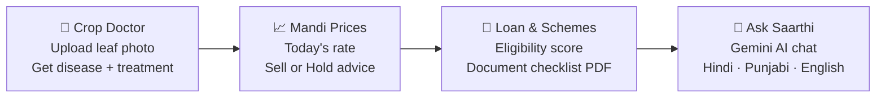

<div align="center">

# 🌾 KisanSaarthi

### *From Farm to Finance, with AI*

**An online, multilingual AI companion that helps new farmers diagnose crop diseases, track mandi prices and discover loan schemes — all in one place.**

<br/>

[](https://your-live-link-here.com)
[](https://your-backend-link-here.com/docs)


**Built by Team Gencoder 💻 · Code Yudh Hackathon 2026 · AgriTech & Rural Transformation**

</div>

---

## 📑 Table of Contents

1. [Problem Statement](#-1-problem-statement)
2. [Our Solution](#-2-our-solution)
3. [Features](#-3-features)
4. [Tech Stack](#%EF%B8%8F-4-tech-stack)
5. [Folder Structure](#-5-folder-structure)
6. [Run It Locally](#-6-run-it-locally)
7. [API Overview](#-7-api-overview)
8. [Future Improvements](#-8-future-improvements)
9. [Team](#-9-team)

---

## 🌱 1. Problem Statement

Farming is changing fast, and **new farmers are entering the field without the experience that older generations had.** They struggle with:

| 😟 Problem | 📉 What happens |
|---|---|
| **Little knowledge about crops** | They don't know which crop types, varieties or seasons suit their land. |
| **Crop diseases go unnoticed** | A spotted or yellow leaf is mistaken for something harmless — the disease spreads and the yield drops. |
| **No idea about market rates** | They don't know today's mandi price, so they sell in a hurry to middlemen at a low rate. |
| **Wrong treatment advice** | They depend on shop dealers who may suggest costly or unnecessary pesticides. |
| **Confusing loan & scheme paperwork** | Schemes like KCC, PM-KISAN and PMFBY exist, but farmers don't know if they qualify or what documents to carry. |
| **Language barrier** | Most useful agri-information is in English, while farmers think in Hindi or Punjabi. |

> 💬 *"A new farmer has the land and the hard work — but not the knowledge, the rates or the guidance."*

---

## 💡 2. Our Solution

**KisanSaarthi** (*Saarthi = guide*) is an online platform that puts an agriculture expert in every farmer's pocket.



One farmer journey: **detect the problem → know the price → get the money → ask anything.**

---

## ✨ 3. Features

| | Feature | What it does |
|---|---|---|
| 🌿 | **Crop Doctor** | Upload a leaf photo and get the disease name, confidence, symptoms, prevention and treatment steps. Unclear photos are flagged honestly instead of guessing. |
| 📈 | **Mandi Prices** | Mandi-wise crop rates with trend charts, nearby mandi comparison and a simple Sell / Hold indicator. |
| 🏦 | **Loan & Scheme Guide** | Checks eligibility for schemes like KCC, PM-KISAN and PMFBY, gives a Credit Readiness Score and a **downloadable PDF checklist** of documents. |
| 🤖 | **Ask Saarthi (AI Chat)** | Ask farming, scheme or loan questions in your own language, powered by **Google Gemini**, with an offline FAQ fallback when the API is unavailable. |
| ☀️ | **Weather & Spray Advisory** | District weather snapshot with spray-window guidance. |
| 🌐 | **Multilingual UI** | Interface in **English, हिन्दी and ਪੰਜਾਬੀ**, with voice input/output. |
| 📱 | **Mobile-first design** | Bottom navigation, large tap targets and simple screens for phone use. |

> ℹ️ **Offline-friendly AI:** If `GEMINI_API_KEY` is missing or Gemini is down, Crop Doctor and Chat still work using built-in demo diagnoses and scheme FAQ answers.

---

## 🛠️ 4. Tech Stack

### 🎨 Frontend
| Technology | Use |
|---|---|
| React 19 | UI components and pages |
| Vite 6 | Dev server and build tool |
| Tailwind CSS 4 | Responsive styling |
| React Router | Page navigation |
| Recharts | Mandi price trend charts |
| i18next / react-i18next | English · Hindi · Punjabi |
| Lucide React | Icons |
| Web Speech API | Voice input and output |

### ⚙️ Backend
| Technology | Use |
|---|---|
| FastAPI | REST API |
| Uvicorn | ASGI server |
| Pydantic v2 / pydantic-settings | Validation + config |
| SQLAlchemy + SQLite | Cache and audit logs |
| ReportLab | PDF document checklists |
| httpx | HTTP client |
| python-multipart | Leaf image uploads |

### 🧠 AI & data
| Technology | Use |
|---|---|
| Google Gemini (`google-genai`) | Live chat + leaf image analysis |
| Offline FAQ / demo catalog | Fallback when Gemini is unavailable |
| Cached Agmarknet-style JSON | Mandi prices for local/demo use |
| Scheme JSON rules | Eligibility scoring + checklists |

### 🧪 Testing & tools
`scripts/smoke_test.py` · `scripts/http_live_test.py` · PowerShell / Batch run scripts · Git & GitHub

---

## 📂 5. Folder Structure

```text
Kisan_Saarthi/
├── backend/
│   ├── app/
│   │   ├── routers/          # /health /diagnose /prices /eligibility /checklist /chat /weather
│   │   ├── services/         # Gemini, disease, mandi, chat, weather, eligibility
│   │   ├── db/               # SQLAlchemy models + SQLite setup
│   │   ├── utils/            # PDF checklist generator
│   │   ├── config.py         # Settings from .env
│   │   ├── schemas.py        # API contracts
│   │   └── main.py           # FastAPI entrypoint
│   └── requirements.txt
├── frontend/
│   ├── public/samples/       # Sample leaf images for Crop Doctor demos
│   └── src/
│       ├── pages/            # Home, CropDoctor, MandiPrices, LoanSchemes, Chatbot, Welcome
│       ├── components/       # Navbar, Sidebar, BottomNav, LanguageSelector
│       ├── api/client.js     # Frontend API client
│       └── i18n/             # en / hi / pa dictionaries
├── data/                     # schemes, eligibility rules, checklists, cached prices
├── scripts/                  # Windows run + smoke test helpers
├── .env.example              # Safe template (copy to .env)
└── README.md
```

---

## 🚀 6. Run It Locally

### Prerequisites
- **Python 3.11+** (on Windows prefer the official installer / `py -3.11`; avoid MSYS2 Python for pip wheels)
- **Node.js 20+**
- A **Gemini API key** from [Google AI Studio](https://aistudio.google.com/) (optional but recommended for live AI)

### Step 1 — Clone & configure
```bash
git clone https://github.com/rajneeshkaur19/Kisan_Saarthi.git
cd Kisan_Saarthi
cp .env.example .env          # Windows: Copy-Item .env.example .env
```

Edit `.env`:
```env
GEMINI_API_KEY=your_gemini_key_here
GEMINI_MODEL=gemini-3.5-flash
```

> 🔒 Never commit `.env` or push API keys to GitHub.

### Step 2 — Backend
```bash
# Windows (recommended)
py -3.11 -m venv .venv
.\.venv\Scripts\Activate.ps1

# macOS / Linux
python3 -m venv .venv
source .venv/bin/activate

pip install -r backend/requirements.txt
python -m uvicorn backend.app.main:app --reload --host 0.0.0.0 --port 8000
```
API docs: **http://localhost:8000/docs**  
Health: **http://localhost:8000/health**

### Step 3 — Frontend
```bash
cd frontend
npm install
npm run dev
```
App: **http://localhost:5173**

### ⚡ Windows one-shot
```powershell
.\scripts\run_all.ps1
```

### 🧪 Smoke tests
```bash
# Offline / contract checks (no live Gemini required)
$env:PYTHONPATH = (Get-Location).Path
.\.venv\Scripts\python.exe scripts\smoke_test.py

# Live Gemini + all features (needs GEMINI_API_KEY and running server)
.\.venv\Scripts\python.exe scripts\http_live_test.py
```

### 🌍 Point frontend at a hosted backend
Create `frontend/.env`:
```env
VITE_API_BASE_URL=https://your-backend-link-here.com
```

---

## 📘 7. API Overview

| Method | Path | Purpose |
|---|---|---|
| `GET` | `/health` | Service + DB + Gemini key status |
| `POST` | `/diagnose` | Leaf image diagnosis (`multipart/form-data`) |
| `GET` | `/prices?crop=&mandi=` | Mandi prices + available crops/mandis |
| `POST` | `/eligibility` | Credit readiness + scheme matches |
| `POST` | `/checklist` | Document checklist + optional PDF (base64) |
| `POST` | `/chat` | Ask Saarthi (Gemini + offline fallback) |
| `GET` | `/weather?district=` | Weather + spray advisory |

Interactive docs: `/docs`

---

## 🔮 8. Future Improvements

### 🚁 Drones + OpenCV for field work
- Use drones for full-field imagery.
- Detect diseased patches, weed spread, stress and water shortage across the field.
- Show a simple colour-coded field health map.

### 📊 Real-world data & trained ML models
- Live Agmarknet / weather / soil feeds.
- Train and validate crop-disease models on large regional datasets (Punjab, Haryana and beyond).

### 🤖 Stronger production AI
- Higher Gemini quotas and longer conversation memory.
- Better grounding against official scheme documents.

### 🗣️ More languages
- Marathi, Gujarati, Bengali, Tamil, Telugu and more.
- Improved voice support for local dialects.

### 🧩 More planned ideas
- [ ] Offline mode for low-network villages
- [ ] Satellite (NDVI) crop health tracking
- [ ] SMS / WhatsApp alerts for price changes and weather
- [ ] Farmer groups (FPO) bulk selling mode
- [ ] Crop calendar and seasonal planning for beginners

---

## 👥 9. Team

**Team Gencoder** — Code Yudh Hackathon 2026, Chandigarh University, Mohali

| Member | Role |
|---|---|
| **Abinashi Singh Panesar** | Team Lead · Finance & Scheme Logic |
| **Anshita Thakur** | Team Member |
| **Rajneesh Kaur** | Team Member |
| **Pushpinder Prashar** | Team Member |

---

<div align="center">

### 🌾 *Empowering every farmer with knowledge, fair prices and easy credit.*

Made with ❤️ by **Team Gencoder**

⭐ If you like this project, give it a star!

</div>
