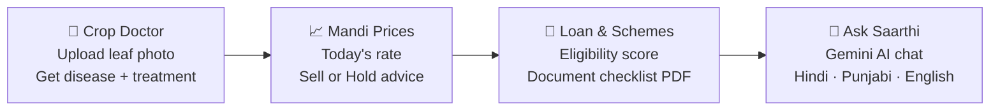

<div align="center">

# 🌾 KisanSaarthi

### *From Farm to Finance, with AI*

**An online, multilingual AI companion that helps new farmers diagnose crop diseases, track mandi prices and discover loan schemes — all in one place.**

<br/>

[](https://your-live-link-here.com)
[](https://your-backend-link-here.com/docs)


**Built by Team Gencoder 💻 · Code Yudh Hackathon 2026 · AgriTech & Rural Transformation**

</div>

---

## 📑 Table of Contents

1. [Problem Statement](#-1-problem-statement)
2. [Our Solution](#-2-our-solution)
3. [Features](#-3-features)
4. [Tech Stack](#%EF%B8%8F-4-tech-stack)
5. [Folder Structure](#-5-folder-structure)
6. [Run It Locally](#-6-run-it-locally)
7. [Future Improvements](#-7-future-improvements)
8. [Team](#-8-team)

---

## 🌱 1. Problem Statement

Farming is changing fast, and **new farmers are entering the field without the experience that older generations had.** They struggle with:

| 😟 Problem | 📉 What happens |
|---|---|
| **Little knowledge about crops** | They don't know which crop types, varieties or seasons suit their land. |
| **Crop diseases go unnoticed** | A spotted or yellow leaf is mistaken for something harmless — the disease spreads and the yield drops. |
| **No idea about market rates** | They don't know today's mandi price, so they sell in a hurry to middlemen at a low rate. |
| **Wrong treatment advice** | They depend on shop dealers who may suggest costly or unnecessary pesticides. |
| **Confusing loan & scheme paperwork** | Schemes like KCC, PM-KISAN and PMFBY exist, but farmers don't know if they qualify or what documents to carry. |
| **Language barrier** | Most useful agri-information is in English, while farmers think in Hindi or Punjabi. |

> 💬 *"A new farmer has the land and the hard work — but not the knowledge, the rates or the guidance."*

---

## 💡 2. Our Solution

**KisanSaarthi** (*Saarthi = guide*) is an online platform that puts an agriculture expert in every farmer's pocket.



One farmer journey: **detect the problem → know the price → get the money → ask anything.**

---

## ✨ 3. Features

| | Feature | What it does |
|---|---|---|
| 🌿 | **Crop Doctor** | Upload a leaf photo and get the disease name, confidence, symptoms and treatment steps. Blurry or unclear photos are flagged honestly instead of guessing. |
| 📈 | **Mandi Prices** | Mandi-wise crop rates with trend charts and a simple Sell / Hold indicator. |
| 🏦 | **Loan & Scheme Guide** | Checks eligibility for schemes like KCC, PM-KISAN and PMFBY, gives a Credit Readiness Score and a **downloadable PDF checklist** of documents. |
| 🤖 | **Ask Saarthi (AI Chat)** | Ask farming, scheme or loan questions in your own language, powered by **Google Gemini** with a grounded fallback. |
| ☀️ | **Weather & Spray Advisory** | Tells whether the weather is suitable for spraying. |
| 🌐 | **Multilingual UI** | Full interface in **English, हिन्दी and ਪੰਜਾਬੀ**, with voice input/output. |
| 📱 | **Mobile-first design** | Works smoothly on a farmer's phone — bottom navigation, big buttons, simple screens. |

> ⚠️ **Demo note:** The Gemini API key used in the live site is a **demo key** with limited quota. If AI chat is slow or unavailable, the app falls back to its built-in knowledge base.

---

## 🛠️ 4. Tech Stack

### 🎨 Frontend
| Technology | Use |
|---|---|
|  | UI components and pages |
|  | Fast dev server and build tool |
|  | Responsive styling |
|  | Page navigation |
| **Recharts** | Mandi price trend charts |
| **i18next / react-i18next** | English · Hindi · Punjabi translations |
| **Lucide React** | Icons |
| **Web Speech API** | Voice input and voice output |

### ⚙️ Backend
| Technology | Use |
|---|---|
|  | REST API framework |
|  | Core language |
| **Uvicorn** | ASGI server |
| **Pydantic v2** | Request / response validation |
| **SQLAlchemy + SQLite** | Database for cache and audit logs |
| **FPDF** | PDF document checklist generation |
| **httpx** | Calls to external APIs |

### 🧠 AI / ML & External APIs
| Technology | Use |
|---|---|
|  | AI chat assistant (demo key) |
| **Kindwise Crop Health API** | Plant disease identification from leaf images |
| **PyTorch + MobileNetV2** | Local crop model (experimental) |
| **Scikit-learn (TF-IDF)** | Retrieval engine for grounded answers |
| **Pillow + NumPy** | Image validation and preprocessing |

### 🧪 Testing & Tools
`pytest` · `oxlint` · `Git & GitHub` · PowerShell / Batch run scripts

---

## 🚀 5. Run It Locally

### Prerequisites
- **Python** 3.11 or 3.12
- **Node.js** 20+
- A **Gemini API key** (free from [Google AI Studio](https://aistudio.google.com/)) and optionally a **Kindwise API key**

### Step 1 — Clone & set up environment
```bash
git clone https://github.com/<your-username>/KisanSaarthi.git
cd KisanSaarthi
cp .env.example .env        # Windows: Copy-Item .env.example .env
```

Open `.env` and add your keys:
```env
GEMINI_API_KEY="your_gemini_key"
KINDWISE_API_KEY="your_kindwise_key"
```
> 🔒 Never commit your `.env` file or push API keys to GitHub.

### Step 2 — Start the backend
```bash
pip install -r backend/requirements.txt
python -m uvicorn backend.app.main:app --reload --port 8000
```
API docs: **http://localhost:8000/docs**

### Step 3 — Start the frontend
```bash
cd frontend
npm install
npm run dev
```
App: **http://localhost:5173**

### ⚡ Windows shortcut
```powershell
.\scripts\run_all.ps1
```

### 🌍 Pointing the frontend to your hosted backend
Create `frontend/.env`:
```env
VITE_API_BASE_URL="https://your-backend-link-here.com"
```

---

## 🔮 7. Future Improvements

We are just getting started. Here is where **KisanSaarthi** goes next:

### 🚁 Drones + OpenCV for field work
- Use **drones** to capture aerial images of full fields.
- Use **OpenCV** to detect diseased patches, weed spread, crop stress and water shortage across the whole field, not just one leaf.
- Give the farmer a simple colour-coded field health map.

### 📊 Real-world data & trained ML models
- Replace the demo data with **real-world, live data** (live Agmarknet prices, weather and soil data).
- Train and validate our own **ML models on large real crop-disease datasets** with proper accuracy testing.
- Improve predictions with local data from Punjab, Haryana and other regions.

### 🤖 Gemini beyond the demo
- The current Gemini key is for **demo purposes only**.
- Move to a production-grade key with higher limits, faster responses and better context memory.

### 🗣️ More languages
- Add **more Indian languages**: Marathi, Gujarati, Bengali, Tamil, Telugu and more.
- Improve voice support for local dialects.

### 🧩 More planned ideas
- [ ] Offline mode for low-network villages
- [ ] Satellite (NDVI) crop health tracking
- [ ] SMS / WhatsApp alerts for price changes and weather
- [ ] Farmer groups (FPO) bulk selling mode
- [ ] Crop calendar and seasonal planning for beginners

---

## 👥 8. Team

**Team Gencoder** — Code Yudh Hackathon 2026, Chandigarh University, Mohali

| Member | Role |
|---|---|
| **Abinashi Singh Panesar** | Team Lead · Finance & Scheme Logic |
| **Anshita Thakur** | Team Member |
| **Rajneesh Kaur** | Team Member |
| **Pushpinder Prashar** | Team Member |

---

<div align="center">

### 🌾 *Empowering every farmer with knowledge, fair prices and easy credit.*

Made with ❤️ by **Team Gencoder**

⭐ If you like this project, give it a star!

</div>
